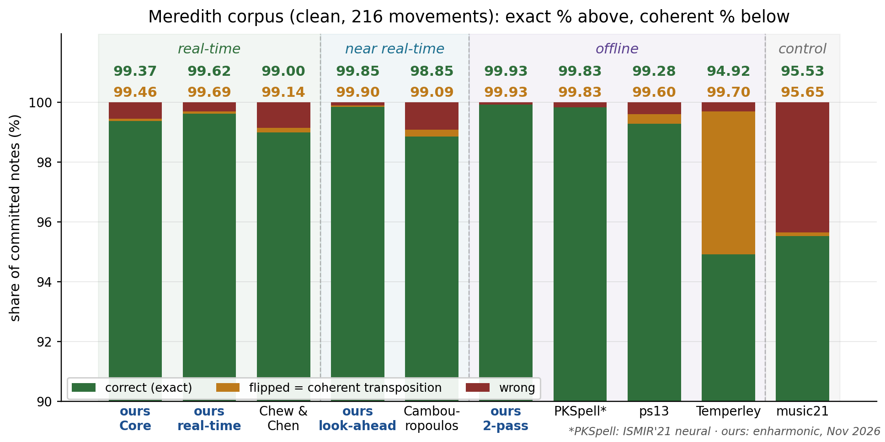

# enharmonic (Python)

**Real-time enharmonic pitch-spelling for MIDI input**, a Python port of the TypeScript
[`enharmonic`](https://github.com/alexisdoualle/enharmonic) library.

Given a stream of MIDI note numbers, it decides whether `61` should be spelled `C♯` or `D♭` from musical
context. Zero runtime dependencies, pure Python 3.10+, Apache-2.0.

**Port status:** matches prod `enharmonic` **`b0b2c86`** (16 Nov 2026) note for note: 0
mismatches over 5.45 M compared notes (60 lab fixtures with and without the notated key, Meredith clean
and noisy, 36 seeded random streams; every mode and option variant). See [Parity](#parity).

**Version:** `0.2.1` (`__version__`), the same version as the npm package. Install with `pip install enharmonic`.

**Speed:** 80,000 to 100,000 notes per second in real time on an Apple M1 Pro, plenty for live MIDI.
See [Performance](#performance).

## Accuracy

Same output as the TypeScript library, so the same scores. Clean Meredith (216 movements, 195,972 notes),
our four modes beside published spellers, grouped by latency (exact % above each bar, coherent % below).
Method and noisy-corpus figures are in the [TypeScript repo](https://github.com/alexisdoualle/enharmonic#status).



## Install

```bash
pip install enharmonic      # from PyPI
pip install -e .            # from this checkout
pip install -e '.[test]'    # + pytest
```

## Quickstart

```python
from enharmonic import Speller, spell_two_pass, spell_events

# Real-time (zero look-ahead)
s = Speller()
for m in (60, 64, 67):
    s.note_on(m, t=0)
print(s.get_spelling(64))          # Pitch(step='E', alter=0, octave=4)
for m in (60, 64, 67):
    s.note_off(m, t=500)

# Near-real-time: feed resolve_dir (and resolve_exact) from a small forward buffer
nrt = Speller(look_ahead=True)
nrt.note_on(61, t=0, resolve_dir=1, resolve_exact=1)   # resolves up to 62 -> C# over Db

# Offline ceiling (whole piece in hand): (midi, t_on, t_off) per note
spelled = spell_two_pass([(60, 0, 500), (64, 0, 500)])  # [PitchClass('C', 0), PitchClass('E', 0)]

# Batch helper: any mode over an on/off event list, look-ahead buffer included
events = [(0, "on", 61), (0, "on", 65), (0, "on", 68), (500, "off", 61), (500, "off", 65), (500, "off", 68)]
spell_events(events, mode="la")   # 'core' | 'rt' | 'la' | 'tp'; one Pitch per on-event
```

## API

| Python | TypeScript | Latency |
|---|---|---|
| `Speller()` | `new Speller()` | real-time |
| `Speller(look_ahead=True)` | `new Speller({ lookAhead: true })` | near-real-time |
| `Speller(key_tonic=-5, onset_tolerance=30)` | `{ keyTonic, onsetTolerance }` | |
| `s.note_on(midi, t=None, resolve_dir=0, resolve_exact=0, outward_partner=None, outward_role=0, local_key=None, degree_key=None, side_key=<omitted>, dominant=None)` | `noteOn(midi, { t, resolveDir, resolveExact, outwardPartner, outwardRole, localKey, degreeKey, sideKey, dominant })` | |
| `s.note_off(midi, t=None)` | `noteOff(midi, { t })` | |
| `s.get_spelling(midi)` -> `Pitch \| None` | `getSpelling(midi)` | |
| `s.get_lof(midi)` -> line-of-fifths int | (Python only; C=0, G=1, F=-1) | |
| `s.set_key(tonic)` (a notated key-signature change: the signature names the collection until the music contradicts it), `s.reset(scale=None)`, `s.get_resolved_scale()` | same | |
| `spell_two_pass(notes, TwoPassOptions())` | `spellTwoPass(notes, opts)` | offline |
| `TwoPassOptions(aug6_outward=True, aug6_wedge=True, aug6_first_move_meet=True, aug6_chord_meet=0, leading_tone_gate=True, key_degree_gate=True, run_boundary=True, triangle_free_context=True, key_side=True, key_return=True, struck_triad_third=True, key_signatures=None, key_signature_anchor=True, short_flip=True, run_repair=True, onset_tolerance=0, ...)` | `{ aug6Outward, aug6Wedge, aug6FirstMoveMeet, aug6ChordMeet, leadingToneGate, keyDegreeGate, runBoundary, triangleFreeContext, keySide, keyReturn, struckTriadThird, keySignatures, keySignatureAnchor, shortFlip, runRepair, onsetTolerance, ... }` | |
| `spell_two_pass_traced(notes)` | `spellTwoPassTraced` | (introspection) |
| `CoreSpeller(...)` | `CoreSpeller` (src/core.ts) | real-time |
| `drive(speller, events)`, `on_notes(events)`, `spell_events(events, mode)` | `test/eval/fixtures.ts` | batch |
| `resolve_step`, `resolve_exact_step` | same | |
| `outward_pairs(notes, look=8, first_move_meet=True, chord_meet=3)` -> `OutwardPairs(partner, role)` | `outwardPairs(notes, look, { firstMoveMeet, chordMeet })` (aug6 context for look-ahead) | |
| `resolution_dirs(notes, mode="own-voice", window=16, max=128)` -> `ResolutionDirs(dir, exact)` | `resolutionDirs(notes, { mode, window, max })` (`resolve_dir` / `resolve_exact`: the 16-note buffer, then the note's own voice) | |
| `side_keys(notes)` -> `list[float \| None]` | `sideKeys` (key -> side context for look-ahead: `side_key`; NaN = the F#/Gb tie) | |
| `centred_side_keys(notes, radius=48, key_return=True)`, `anchored_side_keys(notes, sigs, inferred)` | `centredSideKeys`, `anchoredSideKeys` (the two-pass side keys) | |
| `dominant_chords(notes, reach=16)` -> `list[DominantChord \| None]` | `dominantChords(notes, { reach })` (tendency-tone context for look-ahead: `dominant`) | |
| `local_keys(notes, table="tonic-triad", radius=12, unit="onsets")` -> `list[LocalKey \| None]` | `localKeys(notes, { table, radius, unit })` (leading-tone gate context for look-ahead) | |
| `degree_keys(notes)` -> `list[LocalKey \| None]` | `degreeKeys` (key-degree gate context: tonic-triad table on +-12 notes) | |
| `Pitch`, `PitchClass`, `Interval` (frozen dataclasses), `midi_of`, `pitch_class_value`, `pitch_to_string`, `interval_between`, `interval_label`, `enharmonic_candidates_for` | same | |

`Speller.engine.decision()` returns the last note's per-candidate score breakdown
(`DecisionCandidate`: base, guard, look-ahead, double-accidental, vertical, leash, lean).

Read-back follows the TypeScript semantics: read a note's spelling **at its note-off** (a later note of
the same onset may revise it); `t` groups co-struck notes into one onset.

### Module map (one Python module per TypeScript file)

| TypeScript `src/` | Python `src/enharmonic/` |
|---|---|
| `pitch.ts` | `pitch.py` |
| `interval.ts` | `interval.py` |
| `lof.ts` | `lof.py` |
| `candidates.ts` | `candidates.py` |
| `scoring.ts` | `scoring.py` |
| `kernel.ts` | `kernel.py` |
| `aug6.ts` | `aug6.py` |
| `key.ts` | `key.py` |
| `key-side.ts` | `key_side.py` |
| `dominant.ts` | `dominant.py` |
| `resolution.ts` | `resolution.py` |
| `core.ts` | `core.py` |
| `engine.ts` | `engine.py` |
| `speller.ts` | `speller.py` |
| `two-pass.ts` | `two_pass.py` |
| `index.ts` | `__init__.py` |
| `test/eval/fixtures.ts` `drive`/`onNotes`/`predict`, `test/eval/meredith.ts` `predict` | `drive.py` |
| (JS number semantics: `%`, `Math.round`, `Math.sign`) | `_js.py` |

### Not ported

The visualiser, MIDI/MusicXML import/export, the chord/Tonnetz/spirals helpers (`viz/`, `test/chord`,
`liveTonnetz`, `spirals`, `slots`, `export`, `import` tests), the scoring/benchmark tooling
(`test/eval/score.ts`, the three-tier scorer) and `examples/`. The port covers the speller and its public API.

## Performance

Pure CPython 3.12.13 on an Apple M1 Pro, Meredith corpus (195,972 notes per variant), median of 3 runs,
spelling time only. The TypeScript column is the prod library on Node (V8), same machine, clean set.
Look-ahead and two-pass include finding the augmented-sixth pairs (`outward_pairs`, about 0.4 s here), the
local keys (`local_keys`, about 0.7 s clean) and the key-degree keys (`degree_keys`, about 0.9 s clean).

| mode | clean | notes/s (clean) | noisy | notes/s (noisy) | TypeScript notes/s |
|---|--:|--:|--:|--:|--:|
| core | 0.53 s | 371,000 | 0.49 s | 400,000 | ~1,740,000 |
| real-time | 2.44 s | 80,000 | 2.02 s | 97,000 | ~232,000 |
| look-ahead | 4.90 s | 40,000 | 4.95 s | 40,000 | ~162,000 |
| two-pass | 5.24 s | 37,000 | 6.00 s | 33,000 | ~94,000 |

Timings depend on the CPU and the Python build; reproduce on your machine with `python bench/bench.py`
(`--sets clean,noisy --modes core,rt,la,tp --repeats 3`; it prints the machine and separates driver from
speller time). The hot paths are optimised without changing a single spelling: integer sums are regrouped
freely, but every floating-point sum keeps the TypeScript order, and the diatonic frame decides from
approximate counts only when the decision is certain (`tests/test_frame_fastpath.py` checks it against
the exact fold at every note). `local_keys` likewise ranks keys from float prefix sums and defers any
near-tie to the exact computation (`tests/test_lt_gate.py` checks it against `local_keys_exact`).

## Parity

The port is only useful if it cannot silently drift from the TypeScript library. `parity/` holds the
machinery:

| file | role |
|---|---|
| `parity/export.sh` + `export.mts` | extract a prod commit (`git archive`, prod's working tree untouched), run it with prod's own `tsx`, write `parity/goldens/*.json.gz` |
| `parity/goldens/` | per-note spellings (line-of-fifths ints, `null` = no read-back) for every input set and mode, the prod commit, and the input hashes |
| `parity/inputs/random.json` | 36 seeded random event streams (`parity/gen_random.py`) |
| `parity/harness.py` | Python replay of every golden input |
| `parity/check.py` | report: notes compared and mismatches per set and mode |
| `parity/sync.sh` | re-export from a prod commit, diff against the committed goldens, replay through the port |
| `parity/diff_goldens.py` | per-mode note diff between two exports |

Input sets and modes:

- **random**: 36 streams, 37,215 notes (chords up to 10 notes, unisons, overlapping same-pitch voices,
  long rests, MIDI 0..127, zero-length and never-released notes, stray note-offs, shuffled tie order,
  float-time spread chords). Modes `core rt la tp` plus option variants `rt_tol30 la_tol30 rt_key3
  rt_keym5 la_keym5 core_g0_r0 core_dap2 tp_honor tp_bwoff_m2 tp_nocentre tp_tol30 tp_aug6off tp_ltoff
  tp_meetoff tp_kdgoff tp_chord3 tp_runoff tp_trioff tp_sideoff tp_retoff tp_triadoff tp_sfoff tp_rroff tp_sigm6
  tp_sigvar tp_sigoff`, and engine-option variants the Speller does not expose (`rt_twinoff`
  frame_twin off, `rt_mltoff` minor_leading_tone off, `la_pvoff` aug6_passing_voice off).
- **fixtures**: the lab's 60 fixtures (`~/JavaScript/enharmonic-lab/fixtures/*/events.json`), 322,426
  notes, `core rt la tp`, and keyed runs over all 60 (`rt_keyed la_keyed`: `key_tonic` / `set_key` from
  each fixture's respell events; `tp_keyed`: `key_signatures`; the key hint is stored with the goldens);
  the 7 curated prod fixtures also run the option variants.
- **meredith-clean / meredith-noisy**: 216 movements each, 195,972 notes, driven exactly like
  `test/eval/meredith.ts` (125 ms per tatum, look-ahead with every context prod's harness feeds).
- **traces**: per-note `DecisionCandidate` rows (rt, la) and the two-pass forward/backward/merge trace
  for 2 fixtures and 3 random streams, to localise any divergence.
- **pure**: `letter/acc/pitchClass/letterAt/collectionAt/candidates/consonance/intervalScore/intervals/
  midiOf/resolveStep` over grids including negatives and exact .5 ties.

The fixture and Meredith **inputs are not copied into this repo** (size, and the Meredith corpus is
fetched, not redistributed): the goldens record each input's SHA-256, and the tests read the inputs from
`ENHARMONIC_LAB_FIXTURES` (default `~/JavaScript/enharmonic-lab/fixtures`) and `MEREDITH_CORPUS`
(default `~/JavaScript/enharmonic/corpora/meredith`, fetched by prod's `scripts/fetch-meredith.sh`).
A changed input fails its test ("re-export"); a missing one skips it.

### Workflow

```bash
python3 -m venv .venv && .venv/bin/pip install -e '.[test]'

.venv/bin/pytest -m "not slow"         # pure + random + fixtures + traces + speller tests (~4 min)
.venv/bin/pytest                       # + Meredith clean/noisy (~3 min more)
.venv/bin/python parity/check.py       # the per-set/mode table

parity/sync.sh                         # prod main changed? does the port still match?
parity/sync.sh <rev> --update          # adopt a new prod commit's goldens (only if the port matches)
```

When prod changes: run `parity/sync.sh`. The first table says which modes' spellings prod changed; the
second says whether the port reproduces them. Port the change (one Python module per TS file keeps the
diff small), rerun until 0 mismatches, then `parity/sync.sh <rev> --update` and update the commit hash
at the top of this README.

### Porting notes (where Python and JavaScript differ)

- `%`: TS writes `((x % n) + n) % n`, which is Python's `x % n`; the only bare `%` on a possibly negative
  value is `midi % 12` (never negative for MIDI). `_js.js_mod` exists for completeness.
- `Math.round` rounds .5 toward +infinity (`_js.js_round`); Python's `round` is banker's. It matters in
  `letter_at` on the mean-fold's fractional centre.
- `Map`/`Set` iteration is insertion order; Python `dict` (used as an ordered set too) matches, including
  "re-setting a key keeps its position". Deleting during iteration is done over a snapshot, which visits
  the same elements.
- `??` on values that can be 0 (a line-of-fifths 0 is C) is `is None`, never `or`.
- Two-pass: a note never read back is `undefined` in TS; `undefined - x` is `NaN` and silently changes
  the merge's branches (`undefined === undefined` agrees; JS `sort` puts `undefined` last). The port
  reproduces this with `None` and NaN (`two_pass._num`); the random set has zero-length notes that hit it.
- The diatonic frame's recency weight `Math.pow(0.5, 1/64)` is bit-identical in V8 and CPython (tested),
  and the float sums keep the TS summation order.
- Sorts are stable in both languages; every comparator is a lexicographic key.

## License

Apache-2.0, as the TypeScript library. The interval-quality formula is adapted from Brian Bowman's
meantonal (MIT), as in the original.
